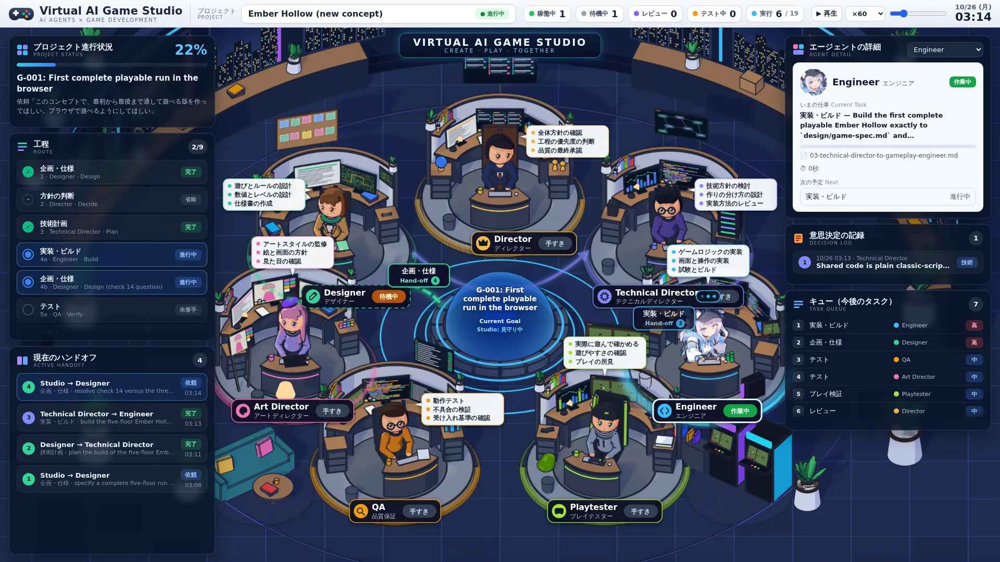
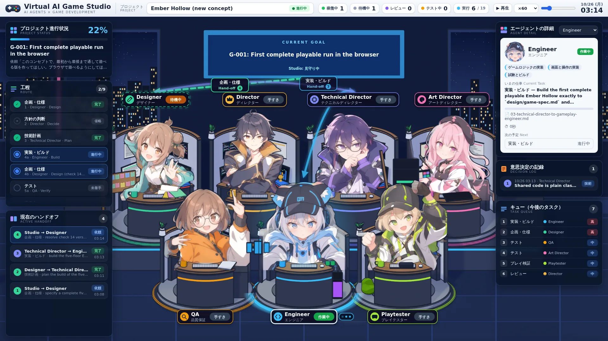
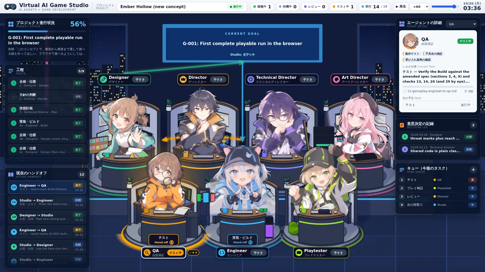
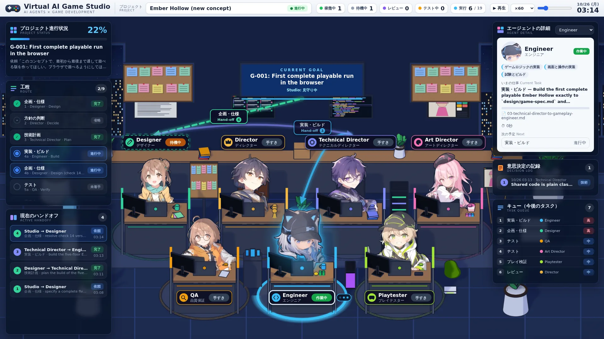
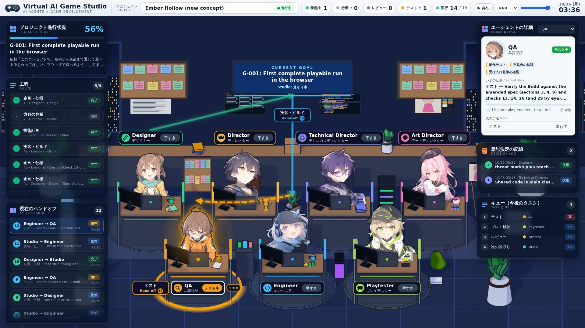
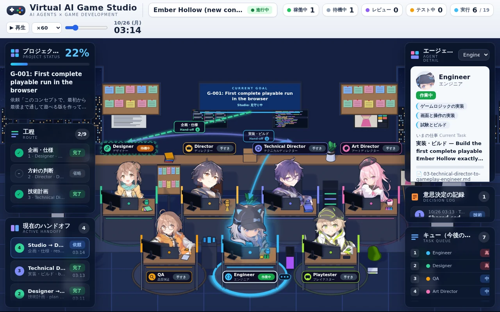
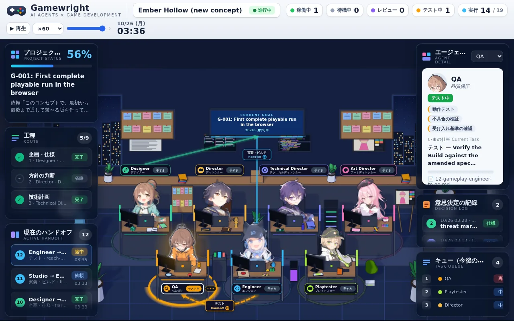
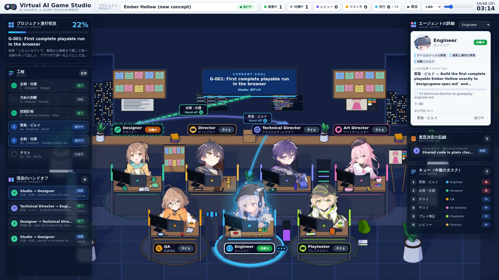
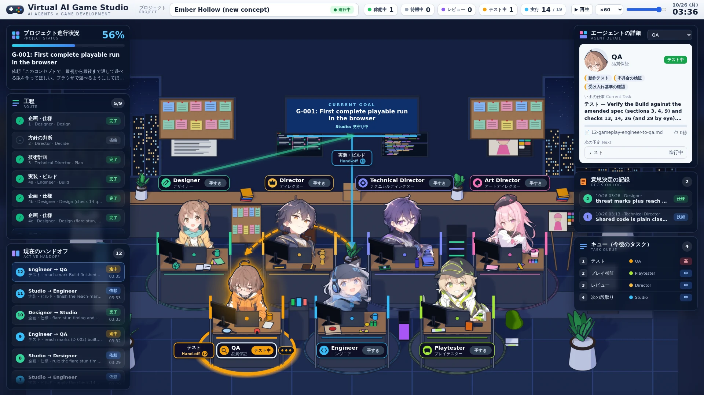

# Phase 19 設計：7 人の AI エージェントの働きを見る「バーチャルオフィス」

状態: **完了**（2026-10-27 設計・実装）。結果は §7。ライブの観察は、Phase 20 の大きなゲームの run で行う。

## 1. 課題

- Studio の働きは、すべてファイル（Handoff、Decision、Goal の記録、実行の記録）に残っている。しかし、それを読めるのは開発者だけである。
- 製品として売るとき、「各役職に分かれてちゃんと動いていること」が目に見えないと、買い手は不安になる（Owner の指摘）。
- 必要なのは、Studio の中身を変えずに、いま誰が何をしていて、誰から誰に何が渡り、何が決まったかを、一目で分かる画面にすることである。

## 2. 方針

- **見るだけ。** Studio とランナーの動きは変えない。UI は、ワークスペースのファイルを読むだけで、書かない。
- **2 つの見方。**
  - **ライブ:** 動いている run を、そのまま観察する。
  - **リプレイ:** 記録済みの run を、時間を早送りして再生する。売り込みや振り返りで使う。
- **依存なし。** Python の標準ライブラリのサーバーと、1 枚の HTML ページ。ネットワークの外部資源は使わない。
- **Owner 向けの言葉で。** 画面の文言は、プロジェクトの `owner_language`（今回は日本語）に合わせる。

## 3. 設計

### 3.1 全体の形

```text
ワークスペース（project/, records/）
   │ 読むだけ
   ▼
scripts/studio_office.py ── 状態を組み立てる（純粋な関数）
   │  serve: 127.0.0.1 だけで待ち受け、/api/state を返す（ライブ）
   │  export: 記録から時系列のスナップショットを作り、JSON に書き出す（リプレイ）
   ▼
scripts/office/office.html ── 画面（ライブは 1.5 秒ごとに取得、リプレイは JSON を再生）
```

### 3.2 状態の組み立て（`office_state`）

ワークスペースのファイルだけから、次のものを作る。

| 項目 | どこから |
|---|---|
| プロジェクトと Goal（名前、状態、Owner の依頼、予算と使った数） | `project.md`、`goal.md`、記録の数 |
| 工程の進み（route 表の各行と状態） | `goal.md` の route 表 |
| 7 人の状態（作業中・待機中・手が空いている）と、いまの仕事 | 作業中は「`packet.md` があって `record.json` がまだない記録」、待機中は「route 表で open の行の担当」、仕事の中身は受け取った Handoff の Task |
| Studio（段取り役）の状態 | 作業中の記録が Route / Intake / Resume のとき「段取り中」 |
| 受け渡し（Handoff） | Goal の Handoff ファイル（送り手、受け手、工程、結果、題名、書かれた時刻） |
| 決定の記録 | `decisions/` の Decision（番号、題名、決めた人、日付） |
| 実行ログ | 記録から作る出来事（工程の開始と終了、実行の要求とその結果、ランナーの試験、差し戻し、画面の撮影） |
| これからの仕事 | route 表の planned / tentative / open の行 |

- 役割ごとの作業中の呼び方: QA は「テスト中」、Playtester は「プレイ中」、Director は「レビュー中」、ほかは「作業中」。
- 時刻は、記録の `started` と `seconds` から決める。Handoff や Decision の時刻は、それを書いた記録が終わった時刻にする。

### 3.3 リプレイ（`export`）

- 記録の時刻から出来事の列を作り、各出来事の直後の状態を、時刻つきのスナップショットとして並べる。
- 画面は、再生、一時停止、速さ（10 倍〜600 倍）、時間のつまみで操作する。
- 書き出した JSON とページを一緒に渡せば、サーバーなしでも再生できる（claude.ai のページとして共有できる）。

### 3.4 画面

参考: Owner から受け取った画面のイメージ（中央の円卓の周りに 7 つの席、左に進み具合と受け渡し、右にエージェントの詳細と決定の記録、下に実行ログとこれからの仕事）。

- **上の帯:** プロジェクト名、Goal、状態、作業中・待機中などの人数、予算の使用量、時計（ライブは今の時刻、リプレイは記録の時刻）。
- **中央のオフィス:** 円卓の中心に Goal、周りに 7 人の席。
  - 席には、役割の色のアバター、名前（日本語と英語）、状態の札、受け持ちの 3 項目。
  - 作業中の席は光り、タイピングの印が動く。
  - 受け渡しが起きると、送り手の席から受け手の席へ、光が流れる。
- **左:** 工程の進み具合（route 表）と、最近の受け渡し。
- **右:** 選んだエージェントの詳細（いまの仕事、経過時間、最近の行動）。席をクリックすると切り替わる。決定の記録。
- **下:** 実行ログと、これからの仕事。

### 3.5 安全

- サーバーは `127.0.0.1` だけで待ち受ける。受けるのは決まったパス（ページ、`/api/state`）だけで、任意のファイルは返さない。
- 画面は、データを必ず `textContent` で入れる。`innerHTML` にデータを入れない（Phase 17・18 の XSS の教訓）。
- ページは Content-Security-Policy で、外部への接続を禁じる。

## 4. 退けた案、見送った案

| 案 | 理由 |
|---|---|
| ランナーに「いま何をしているか」を書き出す処理を足す | 「Studio は完成済み、目的は視覚化のみ」という依頼に反する。記録のファイルだけで、作業中かどうかを判定できる |
| WebSocket でのプッシュ | 依存かコードが増える。1.5 秒ごとの取得で十分に「リアルタイム」に見える |
| フレームワーク（React など）を使う | 依存を増やさない。1 枚の HTML で足りる |
| 画像の素材（イラスト）を使う | 手元に素材がなく、外部の画像は使わない。アバターと机は SVG で描く |

## 5. 変更するファイル

| ファイル | 変更 |
|---|---|
| `scripts/studio_office.py` | 新規。状態の組み立て、ライブのサーバー、リプレイの書き出し |
| `scripts/office/office.html` | 新規。画面（HTML、CSS、JavaScript を 1 ファイルに） |
| `tests/test_phase19.py` | 新規 |
| `docs/phase19.md` | 本書と結果 |
| `AGENTS.md`、`CLAUDE.md` | 使い方を 1 行ずつ |

`studio/` とランナー（`studio_run.py`）は変えない。

## 6. 検証計画

**決定的テスト**

- 記録済みの run（`p17-ember-run`）から状態を組み立てると、工程、受け渡し、決定、ログが記録と合う。
- ある時刻のスナップショットで、その時刻に作業中だった役割が「作業中」になる。
- 作業中の記録（`record.json` のない記録）があると、その役割が作業中になる。
- サーバーは決まったパスだけを返し、ほかは 404 になる。`127.0.0.1` だけで待ち受ける。
- ページに、データを `innerHTML` に入れる書き方がない。

**目視の確認**

- リプレイを手元のブラウザで開き、画面を撮って確かめる。
- Phase 20（大きなゲーム）の run を、ライブで観察する。

## 7. 結果

### 7.1 できたもの

- `scripts/studio_office.py`（状態の組み立て、ライブのサーバー、リプレイの書き出し）と、`scripts/office/office.html`（画面）。
- 使い方:

  ```text
  python3 scripts/studio_office.py serve  <ws>          # ライブ: http://127.0.0.1:8765/
  python3 scripts/studio_office.py export <ws> <dir>    # リプレイ: office.html と timeline.json
  ```

- Phase 17 の run（Ember Hollow を作った過程）のリプレイを、claude.ai のページとして Owner に渡した。
  - 43 枚のスナップショット、約 375KB。
  - 再生、速さ、時間のつまみで操作できる。

### 7.2 決定的テスト

- 192 件すべて成功。`tests/test_phase19.py` は 8 件。
  - 最後のスナップショットが、記録（工程、受け渡し、決定）と一致する。
  - ある時刻に作業中だった役割が「作業中」（QA は「テスト中」、Playtester は「プレイ中」）になり、受け取った Handoff の仕事の中身が出る。
  - リプレイのある時刻には、その時点にあったものだけが出る（最初の Route の時点では、Decision はまだない）。
  - 書きかけの記録（`record.json` のない記録）があると、その役割が作業中になる。
  - サーバーは `127.0.0.1` だけで待ち受け、ページと `/api/state` 以外は 404 を返す（プロジェクトのファイルも、ランナーのコードも返さない）。
  - ページに `innerHTML` などの書き方がなく、CSP で外部への接続を禁じている。
  - 書き出しが、ページと時系列を書く。

### 7.3 目視の確認

- Phase 17 の run のリプレイを、手元のブラウザで開いて画面を撮った。コンソールのエラーはなかった。
- 最初の画面で見つけた 4 点を直した。
  - 席の名札で、長い英語名が状態の札と重なっていた。
  - 中央の Goal 名が、円からはみ出していた。
  - 受け渡しの題名に、送り手と受け手が二重に出ていた。
  - 実行ログの名前の列が折り返していた。

### 7.4 わかっていること

- 作業中かどうかは、記録のファイルの有無で決まる。1 つの工程の中の細かな進み（実行の要求の途中など）は、工程が終わるまで出ない。
- ライブのサーバーは、手元のマシンでだけ開ける（`127.0.0.1`）。ほかの機器から見るには、リプレイを書き出して渡す。

## 8. 見た目の作り直し（2026-10-27）

Owner の評価は「視覚化のコンセプトは合っている。デザインが残念すぎるので、渡した画像のレベルに仕上げて」だった。仕組み（何を、どこから読んで出すか）は変えず、見た目だけを作り直した。

- **オフィスの床（すべて SVG で描画、外部の画像なし）**
  - 窓のある奥の壁と、円いフロア。床にはアイソメ風の格子。
  - 7 つの席は台座、モニター 3 枚、椅子、手前の机（キーボード、マグ、ノート）、観葉植物で描いた。
  - 人物はデフォルメ調。髪型と小物（王冠、メガネ、ヘッドホン、ベレー帽、キャップ）を役割ごとに描き分けた。
  - 受け持ち 3 項目の吹き出しと、名札（英語名、日本語名、状態の札）。
  - 作業中の席は、台座が役割の色で光る。モニターの表示が動き、頭の横にタイピングの印が出る。
- **中央のハブ**
  - 光る球体に、Goal の番号と題名（最大 3 行、幅を測って折り返す）、Studio の状態を出す。
  - 周りの輪は、工程ごとの進み具合を担当の色で示す。
- **受け渡しの矢印**
  - 場所の組ごとに最新の Handoff を最大 4 本、曲線の矢印で描く。新しいものほど濃い。
  - 新しい 2 本には「工程名 Hand-off 番号」の札をつけ、古いものは番号だけ。
  - 札は、名札、吹き出し、ハブの文字に重ならない位置を、曲線上の候補から選ぶ。
  - 新しい Handoff が届くと、光の玉が矢印に沿って流れる。
- **周りのパネル**
  - 上の帯: 状態ごとの色つきの人数（稼働中、待機中、レビュー、テスト）と、実行の使用数と予算。
  - 左: 工程を日本語の工程名で表示（Design → 企画・仕様 など）し、色つきの札をつけた。受け渡しは番号つき。
  - 右: エージェントの詳細を白いカードにした。
    - いまの仕事、担当工程の進み具合のバー、受け取った Handoff のファイル名、経過時間、次の予定、受け持ちを出す。
    - 席を誰も選んでいなければ、作業中の人を自動で表示する。
  - 決定の記録には、決めた役割の札をつけた。
  - 下: 実行ログは 2 段組み。キューには優先度の札をつける（進行中は「高」、予定は「中」、保留は「低」）。
- **状態の組み立てへの追加:** 作業中・待機中のエージェントに、受け取った Handoff のファイル名（`file`）を足した。
- **確認**
  - Phase 17 の run のリプレイと、Phase 20 の run のライブを、手元のブラウザで撮った。どちらもコンソールのエラーはない。
    - ライブでは、`timeline.json` を探して 404 になる 1 件だけがコンソールに出る。これは想定どおり。
  - 幅 390px、1280px、1920px で、横にはみ出さない。
  - テストは 192 件すべて成功（`test_phase19.py` に `file` の確認を足した）。

## 9. 画像素材で作り直し（2026-10-27）

Owner から 2 回目の依頼があった。「人物、机、背景が単純な図形で、目標の画像と比べて品質が大きく足りない。すべてを CSS/SVG で描くことにこだわらず、静的な要素は画像素材を優先して検討する」。

### 9.1 方式の判断

- 調査結果: 画面は 1 枚の HTML で、床、机、人物をすべて SVG の図形で描いていた。画像素材は使っていなかった。
- 手元で使えるもの: Blender 5.2、GPU（RTX 4070 Ti、CUDA）、Stable Diffusion XL の重み（キャッシュ済み）。
- **採った方式: Blender で 3D のスタジオと 7 人をコードから組み、固定カメラで描画する。**
  - 静的な絵は画像にする: 部屋、机、モニター、植物、ハブ、人物。
  - 変わるものと操作は、これまでどおり HTML/SVG で重ねる: 名札と状態、作業中の光、矢印と札、Goal の表示、クリック。
  - カメラが固定なので、描画のときに各席の画面上の位置を `layout.json` に書き出せる。重ねる UI は、その座標に正確に合う。
  - 作業中の見た目（画面の点灯、照明、作業の姿勢）は、席ごとの「作業中」の層として描画する。ほかの物を holdout にして、その席だけを切り出す。画面では、状態に合わせて重ねたり外したりする。
- 退けた案:
  - Stable Diffusion で絵を描かせる案。7 人の一貫性と、席の位置の制御が難しい。人物を背景から切り抜く処理も要る。
  - 3D をブラウザで描く案（three.js など）。依存が大きく増える。静的な絵にリアルタイム描画は要らない。
  - モックの画像を貼る案。依頼で禁止されている。

### 9.2 作ったもの

- `scripts/office/make_assets.py`: テクスチャを作り（PIL）、Blender を呼び、光のにじみをつけて WebP にする。
  - テクスチャ: 7 人の顔、モニターの画面、コルクボード、窓の夜景。
- `scripts/office/scene.py`: Blender のシーン。
  - 部屋: 円い床、窓と植物のある壁。
  - 中央のハブ: ガラスのドームとワイヤーの地球儀。
  - 7 つの席: 台座、光る縁、モニター 3 台、机、椅子、ランプ、本、植物、役割ごとの小物。
  - 7 人: メタボールで作り、髪型、服、小物（メガネ、ヘッドホン、ベレー帽、帽子、ネクタイ、スカーフ）を描き分けた。
- 出力（`scripts/office/assets/`、約 0.6MB）:
  - `office.webp`（2560×1400、全員が手すき）
  - `busy-<role>.webp` ×7（その席の作業中の層）
  - `face-<role>.webp` ×7（詳細カードの顔）
  - `layout.json`
- 画面:
  - 描画したスタジオを全幅に置き、左右にガラスのパネルを重ねた（モックと同じ構成）。
  - 画面の高さが足りないときは、部屋の上端（壁）を切る。机は切らない。
  - 名札は名前の長さに合わせた幅にした。
  - 吹き出しは本人の頭の横に置き、しっぽをつけた。札は、名札、吹き出し、頭に重ならない位置を選ぶ。
- サーバー: `/assets/<名前>` で素材を返す。素材のディレクトリにある、決まった形の名前だけを返す。書き出しには素材もコピーする。

### 9.3 確認

- 手順: 実装、スクリーンショット、モックとの比較、改善を繰り返した。独立したサブエージェントにも、モックと比べた見た目のレビューを頼んだ。
- 状態と表示の整合: 記録の 43 時点すべてで、作業中の層、名札の札、人数がデータと一致した（Playwright）。
- 操作: 席のクリック、キーボード（Enter）、選択欄で、詳細カードが切り替わる。コンソールのエラーはない。横にはみ出さない。
- テスト: `test_phase19.py` に、素材の配信、パスの抜け道の拒否、書き出しへの素材のコピーを足した。
- 独立レビュー（サブエージェント、モックと比較）:
  - 1 回目: 7 人の見分けと立体感は合格。仮素材の解消、状態の見え方、情報密度は「一部」。
    - 主な指摘: Playtester の帽子が顔を覆う、ハブの白飛び、手すきと作業中で人物が同じ、吹き出しの帰属が曖昧、番号だけの札、右の列の空白、名札の文字の小ささ。
    - すべて直した。帽子、照明と姿勢、ハブは描画から、配置と札は画面から。
  - 2 回目: 総合「軽微な問題ありで合格」。
    - 残りの指摘も直した: 頭を横切る矢印、待機中と手すきの色の区別、ハブの文字の下地、右の列のパネルの高さ、矢印の太さ、タイピングの印、机の小物（棚、ファイル、人形、付箋）。
- 途中で見つけた手順の誤り: 修正スクリプトと描画を `;` でつないでいたため、修正が失敗しても古いシーンのまま描画されていた。`&&` でつなぎ、修正を確かめてから描画するようにした。

### 9.4 画面

改善前（同じ run の同じ時点、QA が作業中）:


改善後:


改善後、Phase 20 のライブ（3 人が待機中）:


## 10. 中央のスタジオ空間の作り込み（2026-10-27）

Owner から 3 回目の依頼があった。「方向性も機能も良いので、この版をベースに続ける。中央のスタジオ空間がまだ簡易に見える。機能追加ではなく見た目に集中し、席の個別化、人物の玩具感を減らすこと、小物の密度、照明・影・反射・発光、必要なら描画後の 2D 仕上げを優先する」。データ接続、状態表示、クリックは変えていない。

### 10.1 変えたこと

- 席（ブース）:
  - 白い台座を、2 段の明るい灰色の台座と金属の縁に替えた。状態の光は、台座の根元を巻く太い帯にした（作業中だけ強く光る）。
  - 背面に布張りの仕切り（木の笠木と柱）を立て、席ごとのブースにした。机は木の天板と暗い胴にした。
  - モニターを大きくし（席ごとに 3 台の画面の壁）、手すきのときも点けた。画面からの光が机と顔に落ちる。
  - 机の両端に引き出しのキャビネット、仕切りの左に棚（本と人形）、仕切りの上に植物、床にごみ箱を置いた。机の上には書類、本、ペン立て、付箋、ランプ。
  - 役割ごとの物:
    - Director: 革の重役椅子、トロフィー、地球儀、表彰状、柱の上の大画面。
    - Designer: コルクボード、レベル図のポスター、ダイス、ゲームの箱。
    - Technical Director: キャビネットの上のサーバーラック、構成図、コーヒーメーカー。
    - Art Director: イーゼル、色見本、絵の具、人形、ペンタブレット。
    - Engineer: 光る PC 本体、追加のモニター、缶、ゴムのアヒル、コードの印刷物。
    - QA: 柱に立てたバグボード、テスト端末の台、チェックリスト、虫眼鏡。
    - Playtester: ゲーミングチェア、ゲーム機、コントローラー、ビーズクッション、ゲームのケース、大きなテレビ。
- 人物:
  - 質感を、つやのある樹脂から、トゥーン（2 階調の陰と柔らかい縁の光）に替えた。照明の色も少し受ける。
  - 全体を約 12% 小さくし、頭も小さくした。多くは横のモニターの方へ 10〜24 度向けた。
  - 服を描き分けた（ブレザー、カーディガン、パーカー、セーター、ブラウス、T シャツ）。白い服をやめ、ブースの色と重ならない色にした。
  - 肌を温かい色にし、前髪の下に影を描いた。Playtester の帽子は、緑のドームに見えたので、暗い色のつば付きの帽子に替えた。
- 部屋:
  - 床を落ち着いた色にし、ハブの周りに通路の輪と、各席への通路（役割の色の縁）を敷いた。
  - 壁の窓の間にネオン、壁ぎわに棚（植物、本、箱）を置いた。
  - 手前の左右の空いた床に、ラウンジ（ソファ、テーブル、フロアランプ）とアーケード筐体を置いた。
- ハブ: 青く光るガラスのドームにし、台座を分割した金属の輪にした。ワイヤーの地球儀と軌道の輪は、Goal の文字の後ろを横切るので外した。文字の下地も、ドームが透ける青に替えた。
- 照明: 平らな補助光を調整し、背後から青い縁取りの光を足した。机のランプを強くした。
- 2D 仕上げ（`make_assets.py`）:
  - 線: Blender で法線と奥行きの層を別に描画し、その境目から線を引いた（イラストの輪郭線）。画面では約半分の大きさで表示されるので、その大きさでも見える太さにした。作業中の層にも同じ線を引くので、重ねても継ぎ目が出ない。
  - 色: ゆるい S 字のコントラスト、暗部を青く、明部を暖かく、少し彩度を上げ、軽くシャープにした。位置によらない処理なので、作業中の層と元の絵の色が揃う。
- 画面（状態の見せ方だけ。機能は同じ）: 作業中の席は、台座の手前に役割の色の光の帯と、脈打つ太い輪を重ねる。輪は手前の半分だけ描き、奥の半分が人物の顔を横切らないようにした。
- 詳細カードの顔: 人物を小さく、向きを変えたので、顔のカメラを実際の頭の位置と向きに合わせた。ほかの席の物はカメラの前に入らないよう、描画から外す（holdout ではなく exclude）。

### 10.2 確認

- 手順: 実装、スクリーンショット、モックとの比較、改善を繰り返した（全体の描き直しは 7 回）。
- 独立レビュー（サブエージェント、モックと前回の版と比較）:
  - 1 回目: 「前回より明らかに良いが、まだモックの品質ではない」。主な指摘:
    - 作業中の席が見分けにくくなった（光の輪が細い）。
    - 全体が暗い。モニターが小さい。人物が大きく、全員が正面を向いている。
    - 手前の床が空いている。線が表示の大きさでは消える。Goal の文字の後ろをワイヤーが横切る。
  - 直したこと: 上の指摘はすべて直した（台座と仕切りを明るく、モニターを大きく、人物を小さくして向きを変え、状態の帯、手前の家具、線の太さ、ハブ）。
    - 人物を正面からそらしきることはしなかった。顔が役割を見分ける主な手がかりなので、横に少し向けるにとどめた。
  - 2 回目: 中央の空間は「軽微な問題ありで合格」。指摘:
    - 詳細カードの顔のうち 2 枚が欠けた。
    - 状態の輪が人物の胸や顔を横切る。
    - ブースの床がまだ暗い。ハブの中に白い反射がある。
  - 直したこと: 2 回目の指摘もすべて直した。
    - 顔のカメラ、輪は手前の半分だけ、ブースの床を明るく、画面の光、ハブの反射。
    - 顔の欠けを防ぐテストを足した（`test_every_role_has_a_visible_portrait`: 7 人の顔の画像が半分以上不透明）。
- 状態と表示の整合: 記録の 43 時点すべてで、作業中の層、名札の札、人数がデータと一致した（Playwright）。
- 操作: 席のクリック、キーボード（Enter）、選択欄で詳細カードが切り替わり、顔の画像も読み込まれる。コンソールのエラーはない。幅 390、1280、1920 で横にはみ出さない。
- ライブ: Phase 20 の実データで表示できる（3 人が待機中）。
- テスト: 196 件すべて成功。
- 残る差: 人物はまだ頭の大きい 3D のデフォルメで、モックの手描きのイラストとは質が違う。壁の窓の間の小物は増やしていない。

### 10.3 画面

改善後（9.4 の改善前・改善後と同じ run の同じ時点、QA が作業中）:


改善後、Phase 20 のライブ（3 人が待機中）:


## 11. 7 人のキャラクターを主役にする（2026-10-28）

Owner の依頼: 「キャラクター設定画の 7 人を正式採用し、彼らが働く様子を観察できるオフィスにする。キャラクターをステータス表示用のアイコンではなく、仮想オフィスの主役として扱う。円形の配置やカメラに固執しない。ただ大きくして重なりを増やすのは避ける」。設定画は `scripts/office/design/characters.png` に置き、正典とした。

### 11.1 方式

- 調べたこと:
  - 手元の画像生成: Windows 側の Stable Diffusion WebUI にアニメ調の SDXL モデル（AnythingXL）があった。参照画像の見た目を引き継がせる IP-Adapter は Hugging Face から取得した。
  - 生成用の Python 環境はリポジトリの外（`~/.venvs/office-sprites`）に作った。
- 退けた方式:
  - Blender の図形で人物を作る（Owner の指示で不可）。
  - 生成した人物を背景の上にそのまま貼る: 絵に描かれた机や椅子がオフィスの机とぶつかり、大きさも角度も合わなかった。
- **採った方式: 3D のオフィスで配置とポーズを決め、人物は設定画をもとに 2D で描き込む。**
  1. Blender で、人物なしのオフィスと、人物が座る位置の「立て板」（頭と肩の形）を描く。立て板のうち手前の机に隠れない部分を、人物の見える範囲（マスク）として書き出す。
  2. 仮の 3D 人物を置いた下絵（`make_assets.py --guide`）を作る。大きさ、位置、ポーズの目安になる。
  3. `make_sprites.py paint`: 下絵の人物の部分を、設定画の本人を参照画像にして描き直す（SDXL のインペイント＋IP-Adapter、強さ 0.86）。カメラの角度と机の位置に合った人物になる。
  4. アニメ人物向けの切り抜きモデル（isnet-anime）で人物だけを切り出し、マスクで机の手前を隠す。いちばん大きな塊だけを残し、オフィスと同じ色の輪郭線をつける。
  5. 状態ごと（作業中、手すき）に 4 案ずつ描き、同じ乱数の組を優先して選ぶ（`make_sprites.py use`）。選んだ絵は素材として固定し、描き直しても置き換わらない。詳細カードの顔も、手すきの絵から切り出す。
- 作業中の絵は「自分の仕事を見ている（口を閉じて集中）」、手すきの絵は設定画らしい仕草（ピース、手を振る、腕組みなど）にした。状態が変わっても同じ人に見えるよう、髪、帽子、服の特徴を文に固定した。

### 11.2 新しいオフィスの構図

- 円形の 7 席をやめ、2 段のスタジオにした。奥の段（一段高い）に 4 人、手前に 3 人を、奥の人の間に並べる。誰の顔も手前の人に隠れない。
- カメラを低め（仰角 40 度 → 24 度）にし、人物を大きくした。1920×1080 で人物は高さ約 330px、顔は約 120px（以前は人物全体で約 70px）。
- 中央のガラスのドームをやめ、奥の壁に Goal の画面を置いた。画面の上部の HTML の看板は外した（ヘッダーに同じ名前がある）。
- 重ねる表示の決まり:
  - 名札: 奥の段は頭の上、手前の段は机の前（奥の人の机は手前の人の頭の後ろにあるため）。
  - 状態: 作業中の人の後ろに役割の色の柔らかい光。加えて、手前の段は台座の光る輪、奥の段は名札の光る枠（奥の台座は手前の人に隠れるため）。
  - 受け渡しの矢印: 頭（奥の段は名札）から頭へ。人物の絵の後ろを通る。顔、Goal の画面、体を横切らない道を選ぶ。札は人物と名札を避け、置けないときは受け取る人の名札の横に置く。
  - 役割の担当（3 行の説明）は、舞台の吹き出しから詳細カードに移した。舞台は人物を見せる場所にした。
- ほかの直し: 状態の光の脈打ちが不透明度を上書きして、手すきの輪がうっすら見えていた（以前からの不具合）。脈打ちを線の濃さだけにした。詳細カードの名前と状態の札が狭い幅で重なっていたので、札が折り返すようにした。

### 11.3 確認

- 手順: まず Engineer 1 人で構図を試し、実画面で品質を確かめてから残り 6 人を描いた。
- 独立レビュー（サブエージェント）:
  - Engineer の時点: 「直してから進めてよい」。指摘: 頭の上が切れる、背景の切れ端、作業中と手すきの仕草の区別がない、細部が状態で変わる、奥の段の状態の輪が手前の人の顔を横切る、札が人物に乗る、Goal の画面が明るすぎる。
  - 直したこと: 立て板を頭と肩の形にした（頭が切れない）、3D の椅子を外した、いちばん大きな塊だけを残す、作業中は仕事を見る仕草、特徴を文に固定、奥の段の状態は名札の枠に、札は人物を避ける、Goal の画面を小さく暗く。
  - 7 人そろった時点: 「軽微な問題ありで合格」。7 つの基準のうち 5 つは合格、状態の見分け（奥の段）と重なりは「一部」。指摘:
    - Director の髪が設定画の黒ではなく茶色で、作業中の顔が前髪に隠れる。
    - 人物の絵の横や下の端がまっすぐ切れて、貼った紙のように見える。
    - 奥の段の人が作業中だと分かる手がかりが弱い。札とタイピングの印が名札の横に詰まる。
  - 直したこと: Director を描き直した（黒髪、顔の見える仕草）、マスクの縁を少しぼかした、作業中の人の後ろに光を足した、手前の段への札は名札の上を先に試す。
    - 下絵に 3D の椅子が残ると、髪の中に描き込まれることが分かったので、下絵からも椅子を外した。
- 自動の確認（Playwright）:
  - 状態と表示の整合: 記録の 43 時点すべてで、作業中の層、名札、人数がデータと一致。
  - 人物の絵: 43 時点すべてで、7 人それぞれの絵（作業中か手すきか）がデータの状態と一致し、14 枚すべて読み込まれる。
  - 重なり: 9 つの時点で、名札、受け渡しの札、タイピングの印が、どの人物の顔にも体にも乗らず、互いにも重ならない。
  - 操作: 席のクリック、キーボード、選択欄で詳細カードが切り替わる。幅 390、1280、1920 で横にはみ出さない。
- テスト: 197 件すべて成功。`test_every_role_is_a_whole_character_sprite`（7 人とも作業中と手すきの絵とマスクがあり、頭が箱の上や横で切れていない）を足した。
- 素材は約 4.8MB（人物の絵は品質 94 の WebP。同じ倍率で比べて違いは見えない。オフィスの絵は線をにじませないため劣化なし）。

### 11.4 残る点

- 描くたびに細部が変わる。帽子のマーク、袖のワッペン、髪の色味（Technical Director は紺より紫寄り、Designer は少し明るい）、QA の前髪のアホ毛や Playtester のヘッドホンなどの小物は、設定画と少し違う。
- 人物の絵の一部に、背景の切れ端（椅子の一部など）が少し残る。
- 生成に使ったモデル（AnythingXL、IP-Adapter）の利用条件は、外部公開や商用の前に確認が要る。
- 人物を描き直すには CUDA の GPU と上の生成環境が要る（`make_sprites.py` の説明を参照）。

### 11.5 画面

改善前（この依頼の開始時点。Engineer が作業中）:



改善後（同じ時点）:



改善後（QA が作業中）:



## 12. オフィス感とキャラクターの両立（2026-10-28）

Owner の依頼: 「キャラクターは大きく見えるようになったが、オフィス感が薄れて壇上や展示画面のように見える。一部の人物の手や腕が不自然。オフィス感とキャラクターの魅力を両立させる。壇上のように大きく並べる構図は避け、働いている社員として見せる。ただし小さすぎて個性が見えない状態にも戻さない」。

### 12.1 §11 の案の問題

- 壇上に見えた理由:
  - 奥の段が光る線のついた段差で、舞台に見えた。
  - 人物が机に対して大きすぎ（家具を 0.86 倍に縮め、人物を 1.35 倍にしていた）、机や小物がほとんど見えなかった。
  - 7 人が正面を向いて並ぶ集合写真の構図だった。奥の壁の Goal の画面が大きく光り、舞台の背景幕に見えた。
- 手や腕が崩れた理由: 手すきの絵に、ピース、ハート、手を振る、ガッツポーズなど、手を顔の前に上げる仕草を選んでいた。画像生成でいちばん崩れやすい部分を、いちばん目立つ場所に出していた。

### 12.2 中間案

- 空間: 段差をやめ、平らな床に机を 2 列に並べた（奥に 4 席、手前に 3 席を奥の席の間に。間に通路）。
  - 机は長方形で、ノートパソコン、横のモニター、マグカップ、役割の色の光る帯（作業中に明るく）を置いた。机の左右に低い仕切り、後ろに低い背もたれの椅子。
  - 奥の壁に低い棚（本、箱、植物）、役割ごとのボード、ホワイトボード、壁掛けの Goal の画面。部屋の端に植物、ウォーターサーバー、プリンター。
- 人物の大きさ: 人物、椅子、机を同じ倍率（1.1 倍）にし、家具との比率を自然に戻した。カメラは少し高く（仰角 24 度 → 32 度）、広く写す。
- 手を描かない構図:
  - 各席のノートパソコンを人物の正面に置き、画面の裏がカメラを向くようにした。タイピングする手はその陰に隠れる。
  - 手すきの絵は「椅子にもたれて、手は膝の上」（机に隠れる）。手を上げる仕草は生成の禁止語に入れた。
  - 状態は姿勢と表情で見分ける: 作業中はノートパソコンの画面を見る、手すきはもたれてこちらを見る。表情に役割ごとの性格を残した（Director は自信のある笑み、Playtester は満面の笑みなど）。
- 選択中の人だけ、輪郭を役割の色で淡く光らせる。

### 12.3 作り方の変更

- 机と部屋は `scene.py` の `front_desk`、`station`、`build_room` で作り直した。人物、椅子、机を同じ 1.1 倍にし、家具を縮めるのをやめた。
- 立て板（人物の見える範囲）は、頭の上を丸めた形のまま、机の上の板を机の高さに合わせた。手前のノートパソコンの蓋と横のモニターが立て板の手前にあるので、人物のその部分は描かれない（手が隠れる）。
- 背の高いもの（Engineer の猫耳の帽子）は頭の上が切れたので、役割ごとに頭上の余白を足せるようにした（`HEADROOM`）。
- 奥の棚の植木鉢が奥の段の人の頭の真上に重なり、人物の絵に描き込まれた（頭の上の白いかたまり）。棚の物は席の間だけに置いた。
- 参照画像に手の仕草が写っていると（Engineer のピース、Designer のペン）、それが絵に移る。役割ごとに参照の切り取りを頭と肩に狭められるようにした（`ref`）。ただし Engineer のピースはこれでも出たので、手の見えない候補を選んだ。
- 負の文（ネガティブプロンプト）も 77 トークンを超えると黙って切られるので、文と同じく長さを確かめるようにした。
- 生成は 1 枚 11GB ほどのメモリを使う。ほかの作業と重なると強制終了されるので、1 枚ずつ、失敗したらやり直す。

- 独立レビュー（サブエージェント、§11 の版と比較）: 「§11 より良い、軽微な問題ありで合格」。オフィス感、個性、両立、情報の読みやすさは合格。
  - 指摘: 作業中も全員がカメラを見ている（働いている姿に見えない）。Engineer の作業中が腕に顎をのせて寝ているように見える。Director の手がモニターの上に出る。Designer の手すきに手のかけらが残る。床の光る輪が舞台に見える。手前の段の名札が顔から遠い。
  - 直したこと:
    - 下絵の 3D の人物の頭を、作業中はノートパソコンの方へ傾け、文も「ノートパソコンを見下ろす」にして、作業中の 7 人を描き直した。
    - Art Director の作業中のベレー帽が紫に光った。下絵の 3D の人物のベレー帽が紫だったためなので、設定画どおり黒にした。
    - Designer の作業中の文の「考える」が、手をあごに当てる仕草を呼んでいたので「集中」にした。
    - 手すきの床の輪は、敷物になじむ薄い線にした（作業中だけ光る）。手前の段の名札は机の前面に置いた。

### 12.4 確認

- 自動の確認（Playwright）: 記録の 43 時点すべてで状態の表示と 7 人の絵の切り替えがデータと一致。9 つの時点で名札、札、印が人物に重ならない。席のクリック、キーボード、選択欄で詳細カードが切り替わる。幅 390、1280、1920 で横にはみ出さない。
- テスト: 197 件すべて成功（頭が切れていないことの確認を含む）。

### 12.5 画面

改善前は §11.5 の改善後。改善後（Engineer が作業中）:



改善後（QA が作業中）:



## 13. 中間案の仕上げ（2026-10-28）

Owner の評価: 「中間案の方向性で進める。壇上案より明確に良く、オフィス感とキャラクターの個性のバランスが取れてきた」。大きな構図は変えず、軽微な修正を 1 回だけ行う依頼だった。直す点は次の 4 つ。1280px 幅で右パネルが机にかかる。机まわりの小物の差が少ない。Handoff の矢印が机の上を横切る。座り方、視線、接地感が不自然な人物がいる。

### 13.1 変えたこと

- **パネルと机**: 左右のパネル（幅 `max(17.6%, 232px)`）の内側に机が収まる幅まで、部屋の絵を縮める（`office.html` の `.scenewrap`）。
  - 机の床の輪は、絵の中央から幅の 0.316 倍まで広がる。この値に余白を足して 0.33 倍を基準にした。縮めて空いた所には、部屋の絵をぼかして敷いた。
  - 縮む割合は 1280px 幅で 0.90、1920px 幅で 0.93。これまで 1920px 幅でも、輪の端がパネルに触れていた。
  - 1180px 以下（パネルを縦に積む幅）では縮めない。
- **小物**: 各机の手前に、役割ごとの小物を 2 つずつ置いた（`scene.py` の `desk_extras`）。
  - Director: 金の名札、革のフォルダー
  - Designer: 20 面ダイス、開いたスケッチブック
  - Technical Director: 光るチップの基板、水筒
  - Art Director: ペンタブレットとペン、色見本
  - Engineer: ピザの箱、付箋
  - QA: 虫眼鏡、捕まえた赤い虫
  - Playtester: 画面のついた携帯ゲーム機、お菓子の袋
  - どれも低い物で、顔を隠さない。
- **矢印**:
  - 経路の評価に、机（モニターの上端から机の前面まで）を通る点を加えた。
  - 手前の列の人は、奥の列の机の隙間に座っている。そこで、頭へ真上から隙間を下りて入る経路を候補に足した。
  - 人と人の間の弧に、高めの弧も候補として足した。
- **人物**（作り直しは 3 枚だけ）:
  - Engineer の作業中: 帽子が顔を覆い、体が描かれず、頭だけが浮いて見えた。新しく 4 案を描き、顔が見え、肩まであり、横のモニターに目を向ける案（43）にした。
  - Playtester の作業中: 小さく、こちらを見ていた。既にある候補から、体が大きく、画面を見下ろす案（32）にした。
  - QA の手すき: 体が横に傾き、腕が机に伸びていた。新しく 4 案を描き、まっすぐ座って手の見えない案（44）にした。agent card の顔もこの絵から作り直した。
- **素材作りの不具合**: `make_assets.py` が、作業用ディレクトリに残った古い 3D の顔（`face-*.png`）を、スプライトから作った agent card の顔に上書きしていた。顔はスプライトからだけ作るように直した。

### 13.2 確認

自動の確認は Playwright で行い、Ember Hollow の記録全体から 33 の時点を選んで測った。

| 確認 | 変更前 | 変更後 |
|---|---|---|
| 机の床の輪と左右パネルの最小の隙間（1280×720 / 1280×800 / 1440×900 / 1920×1080） | 重なる（4 幅すべて） | 35 / 35 / 37 / 44 px |
| 矢印の上の点のうち、机の範囲に入るもの | 195 / 1746（11.2%） | 13 / 1746（0.7%） |
| 横のはみ出し（390 / 1280 / 1920 幅） | なし | なし |

- テストは 197 件すべて成功した。
- 残っていること:
  - Technical Director と Playtester の手すきの絵は、袖や手が机の上に出ている（今回は直していない）。
  - 手前の 2 人の間の弧（例: Engineer → QA）は、奥の人の胸の後ろを通る。

### 13.3 画面

変更前（1280px 幅。右パネルが Art Director の机にかかる）:



変更後（1280px 幅）:



変更後（1920px 幅、Engineer が作業中）:



変更後（1920px 幅、QA が作業中）:



## 14. 中間案の正式採用と統合（2026-10-28）

Owner の判断: 中間案（§12、§13）を正式に採用する。残る表示の問題を直し、試作の残りを整理して `feat/phase20-big-game` に統合する。

### 14.1 直したこと

- **1280×800 で詳細カードが切れる**: 右の列の最初のパネル（エージェントの詳細）は `overflow: hidden` で、高さが足りないとカードの下（経過時間、次の予定）が切れて、どうやっても見られなかった。
  - カードをパネルの中でスクロールできるようにした。見出しと選択欄は常に見える。
  - パネルに最小の高さ（210px）を与え、顔、名前、状態が先に削られないようにした。
  - 別の人を選ぶと、カードは先頭（顔）から表示する。
- **名称**: 画面のタブとヘッダーの名称を「Virtual AI Game Studio」から「Gamewright」にした（ヘッダーの小見出し「AI AGENTS × GAME DEVELOPMENT」は説明として残した）。
- **整理**:
  - 7 人全員がスプライトになったので、3D の人物の顔を描く処理（`portraits`、`only_pod`）を消した。何も描かなくなっていた。
  - `scene.py` と `make_assets.py` の説明を、今の作り（机の並ぶオフィス、席の立て板とマスク、下絵）に合わせた。
  - 素材（`scripts/office/assets/`、約 3.4MB）と文書の画像は、すべてページ、テスト、文書のどこかが使っている。
  - 試作の途中の 8 つのコミットは、1 つのコミットにまとめて統合した。途中の版の画像（約 18MB）を共有の履歴に残さないため。途中の経過は §9〜§13 に残っている。

### 14.2 確認

- 詳細カードの確認（Playwright）: 選択欄、顔、名前、状態、担当、いまの仕事、ファイル、経過時間、次の予定のそれぞれが、カードの中のスクロールだけで見えるか（パネルをコードでスクロールしたものは数えない）。
  - 直す前: 1280×800 と 1280×720 で、経過時間と次の予定が切れた。
  - 直した後: 1280×800、1280×720、1440×900、1920×1080、390×844 のすべてで見える。

### 14.3 統合後の受け入れ確認（2026-10-29）

統合後の画面を、独立したサブエージェントが「7 人を主役にする」依頼の受け入れ基準で確かめた。総合は「軽微な問題ありで合格」。個性、見え方、状態をまたいだ同一性、7 人の視認性、状態と役割、1920×1080 での大きさ、机で働く姿、手と腕は合格。重なりは「一部」だった。画面だけで直せる指摘を直した。

- **選択中の光が作業中に見える**: 選ばれた人の輪郭を役割の色で光らせていたため、手すきの人が作業中に見えた。白い細い縁取りにした（役割の色の光は作業中だけ）。
- **矢印が人の後ろを通る**: 経路の評価に、人物の箱として小さい立て板の箱を使っていた。描かれた絵の箱にした。
  - 手前の列の 2 人の頭は、間にある奥の列の机と同じ高さにあり、頭と頭を結ぶとその机か奥の人を必ず横切る。この 2 人の間は、名札と名札を結び、名札の下の床を通る弧にした。
  - 経路は 2 次の曲線に加えて、3 次の曲線も候補にした（奥の列の上を水平に進み、隙間を真下に下りる形）。
- **矢印の先が頭の上の空中を指す**: 手前の列の矢印は、絵の箱の上端（Engineer の帽子のための余白を含む）で終わっていた。読み込んだ絵の、最初に色のある行で終わるようにした。

| 矢印の上の点（記録全体、2145 点）| 直す前 | 直した後 |
|---|---|---|
| ほかの人の絵の中 | 14.1% | 0% |
| ほかの人の顔（絵の上半分）の中 | 9.0% | 0% |
| 机の範囲の中 | 1.1% | 5.6%（名札から出る矢印の端が自分の机の前面に乗る分） |

- 絵の残りの指摘も、該当する絵だけ描き直して直した:
  - 原因: 服の色は、下絵の仮の 3D 人物の服の色に引きずられていた（Designer は黄土色、Engineer は紺のパーカー）。下絵の色を設定画に合わせた（Designer は青緑の上着に白、Engineer は白の上着に水色）。
  - Engineer: 作業中と手すきを描き直し、両方とも猫耳の帽子、白い上着、頭の上のヘッドホン 1 つにした。役割ごとの負の文（`avoid`）に「首にかけたヘッドホン、マフラー」を入れた。
  - Designer: 作業中と手すきとも青緑の上着になった。
  - Playtester の手すき: マグカップが袖の上に出ていたのは、描かれた絵の中のマグカップ（下絵から写った）だった。腕の下に机のマグカップが隠れる候補にした。
  - 席の立て板の机の板を、机の上の物（マグカップの縁は机 + 0.12）より上（机 + 0.14）にした。低い物が人物の絵に穴をあけない。マスクを描き直し、14 枚を切り直した（新しく描いたのは上の 5 枚分だけ）。
  - 矢印の先は、2 枚（作業中と手すき）の頭の上端のうち低い方で終わる。数えるのは数画素以上の色がある行だけにした（細いとげや髪の 1 本を頭の上端と見なさない）。
- 2 回目の独立レビュー（直した後）: Engineer の 2 つ目のヘッドホン、Designer の上着、Playtester のマグカップ、矢印、選択の光は解決。Engineer の手すきの帽子と切り抜きのとげが残っていたので、手すきをもう一度描き直した。
- 3 回目の独立レビュー: 上の点はすべて解決、7 人とも作業中と手すきで同じ人に見え、壊れた手や腕はない（総合「軽微な問題ありで合格」）。記録に写らない Art Director の作業中の絵に、肩の後ろの細い灰色の切れ端が見つかったので、既にある候補から切れ端のないもの（41）に替えた。
- 残る軽微な点: Designer の青緑は設定画より淡い。Engineer の作業中の帽子の耳の内側が桃色（設定画は濃い色）。
