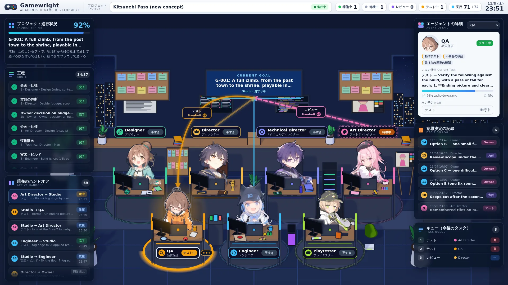
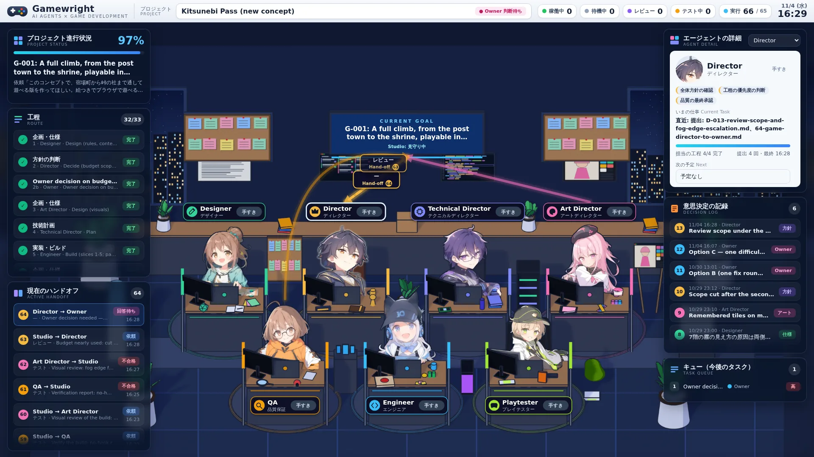
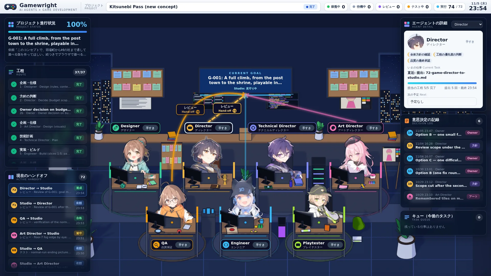

# Phase 21: バーチャルオフィスを実際のゲーム開発で使う

## 1. 目的

Phase 19 で作ったバーチャルオフィスが、監視 UI として実際に役に立つかを確かめる。デモではなく、実在のコンセプト「Kitsunebi Pass」の Goal G-001（宿場町から峠の社まで、絵つきでブラウザで通して遊べる版）を、止まっていたところ（Phase 20、利用上限で停止）から完了まで進めた。その間、画面に出たことと、Studio が実際にしていたことを並べて記録した。

## 2. 測り方

`scripts/office/measure/` の 3 つの道具を使った。

- `truth.py`: 実際の状態。1 秒ごとに `records/` を見て、操作の開始（`packet.md` ができた時刻）と終了（`record.json` ができた時刻）、Goal の状態を記録する。
- `observe.js`: 画面の状態。ライブのオフィス（1920×1080）を 2 秒ごとに読み、作業中の絵になっている人、名札の状態、ヘッダーの数、Goal の状態、Studio の表示を記録する。変化したときと 5 分ごとに画面を撮る。
- `analyze.py`: 上の 2 つを突き合わせる。遅れ（実際の変化から画面に出るまで）と、1 秒ごとの一致率（画面で作業中の人の組 ＝ 実際に動いている操作の役割の組）を出す。

記録は `examples/runs/p21-measure/`（`truth.jsonl`、`screen.jsonl`、`run.log`）にある。撮った画面（約 1,100 枚、1.5GB）はリポジトリに入れていない。

## 3. 開発の経過

| 区切り | 操作 | 内容 | 費用（API 換算） |
|---|---|---|---|
| 再開 | 031〜036 | QA と美術監督が確認、Director が追加予算を Owner に確認 | 約 $1.9 |
| Owner 回答 1（B、9 件追加） | 038〜049 | 結末パネル・霧の階の修正、確認 2 回、Director が再び確認 | 約 $4.8 |
| Owner 回答 2（B、8 件追加。フックなしの踏破記録を必須にした） | 051〜056 | 霧の修正、踏破記録の探索。踏破できず、Studio が難易度調整を確認 | 約 $2.4 |
| Owner 回答 3（C、上限 14 件。難易度調整） | 058〜073 | 難易度を下げ、フックなしの踏破記録（世界 1・シード 4・872 ターン）を作成。霧の端は 2 回目の不合格 | 約 $6.9 |
| Owner 回答 4（B、7 件追加。霧の端を直す） | 075〜082 | 霧の端の色を修正、確認、Review、Close | 約 $2.3 |

結果: G-001 は「達成」で閉じた（予算 72 件を使い切り）。この区間の合計は約 $18.3（48 操作）。費用は Claude CLI が出す API 換算の値で、実際にはサブスクリプションの利用枠から差し引かれる。

## 4. 結果

| 項目 | 値 |
|---|---|
| 計測した操作 | 30（051〜082。実際に動いていた時間の合計 40 分） |
| 開始が画面に出るまで | 中央値 1.3 秒、最大 3.0 秒 |
| 終了が画面に出るまで | 中央値 1.3 秒、最大 3.4 秒 |
| 画面と実際の一致率（変化の直後 5 秒を除く） | 100%（ずれは 1 秒 1 回: 美術監督が作業中なのに画面は手すき） |
| 「Owner 判断待ち」が画面に出るまで | 2.4 秒、3.1 秒（実際の待ちに入った 2 回） |
| 「完了」が画面に出るまで | 1.8 秒 |
| 画面のエラー | なし（`timeline.json` の確認のための 404 は想定どおり） |

- 031〜049 の 18 操作も最初のセッションで同じ方法で測った（遅れの中央値 1.4 秒、最大 3.1 秒、一致率 100%）。その記録ファイルはセッションの一時領域にあり、残っていない。
- 遅れは、ページが記録を読み直す間隔（1.5 秒）でほぼ決まる。監視には十分速い。
- 「Owner 判断待ち」が 15〜18 秒と出た 2 回は、計測の道具を再起動した時の見かけの値で、表示の遅れではない。
- 画面に同時に 2 人が作業中と出たのは 1 回（2.3 秒）だけで、QA の終了と美術監督の開始が重なった読み込みの間だった。

## 5. 分かったこと

- **並行作業は計画だけ。** Studio は「QA と美術監督を並行で」と何度も割り当てたが、`studio_run.py` は操作を 1 件ずつ順に実行する。30 操作のうち時間が重なったものは 0。画面では、並行に割り当てられた 2 人が「待機中」になり、順に「作業中」になる。これは実際どおりの表示である。2 人以上が同時に作業中になる表示は、実際の実行ではまだ試されていない。
- **Owner への確認は、画面だけでは決められない。** Owner の質問は、追加の費用を「操作の件数」でしか書いていない。何をするのか、どれだけの時間と利用枠を使うのか、何が得られるのかが書かれていないので、Owner（この計測では依頼者本人）は「お金を出していいかだけでは許可できない」と答えた。今回は、記録の実測値（1 操作あたり約 $0.2〜0.7、0.5〜3.5 分）から説明を補った。Studio の Owner 確認に、実測に基づく時間と費用の見積もりを書かせるのが次の改善候補（Studio 側の変更）。
- **待っている時間が長い。** 051 以降の計測期間 9,600 分のうち、Studio が動いていたのは 40 分で、残りはほぼ Owner の回答待ち（4 回）だった。画面の「Owner 判断待ち」は正しく出ていたが、画面を開いていない Owner には届かない。通知の仕組みはまだない。
- **WSL では画面読み取り用のブラウザが一度落ちた**（D-Bus の切断）。そのあいだは Owner の回答待ちで操作がなく、計測の抜けは結果に影響していない。

## 6. 残っていること

- 並行作業を実際に同時に動かすか（`studio_run.py` の変更）。動かしたら、画面の同時表示をもう一度測る。
- Owner の確認に、時間と利用枠の見積もりと、得られるものを書かせる（Studio の変更）。
- Kitsunebi Pass の次の Goal 候補は、G-001 の Outcome に Studio が並べている（仕上げ、残りの画面の確認、難易度とテンポなど）。
